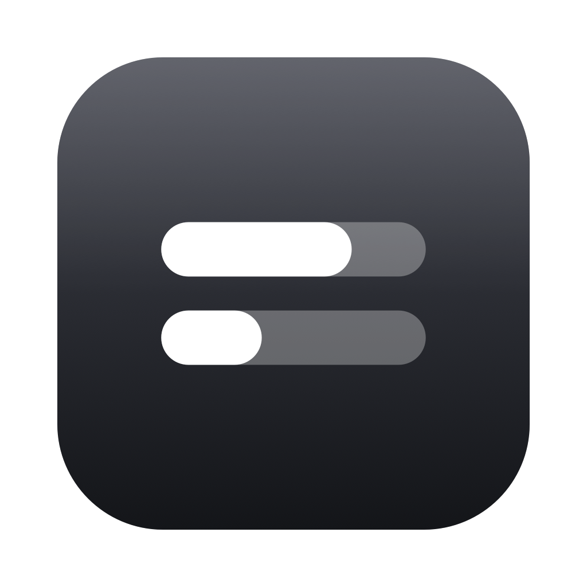

<p align="center">
  
</p>

<h1 align="center">Codex Usage</h1>

<p align="center">极简 macOS 菜单栏 App：直接显示 Codex（ChatGPT Plus）5 小时 / 7 天额度的<strong>剩余进度</strong>与重置时间。</p>

<p align="center">
  <a href="https://github.com/mikeooye/CodexUsage/releases/latest"></a>
  
  <a href="LICENSE"></a>
</p>

## 下载安装

到 [Releases](https://github.com/mikeooye/CodexUsage/releases/latest) 页面下载最新版本：

| 文件 | 说明 |
| --- | --- |
| `CodexUsage-0.1.1.dmg` | 打开后把 **Codex Usage** 拖进「应用程序」（推荐：要用「登录时自动启动」就必须装在 `/Applications`） |
| `CodexUsage-0.1.1-macos.zip` | 解压得到 `Codex Usage.app`，自行拖到 `/Applications` |

发布包是 **universal 二进制**（Apple Silicon + Intel），只做了本地 ad-hoc 签名（项目没有 Apple 开发者证书）。首次打开可能被 Gatekeeper 拦下：在「系统设置 → 隐私与安全性」里点「仍要打开」，或直接去掉隔离属性：

```bash
xattr -dr com.apple.quarantine "/Applications/Codex Usage.app"
```

想自己编译，见下面的[从源码构建 .app](#从源码构建-app)。

## 要求

- macOS 13+
- 已安装并登录 Codex —— **装了 ChatGPT.app 就够了**（它自带 `codex`），也可以换成独立安装的 Codex CLI
- 只有自己编译才需要 Xcode / Command Line Tools

> **当前适配的 Codex 版本：`codex-cli 0.158.0-alpha.2.1`**（随 ChatGPT.app `26.924.22138` 分发，入口
> `/Applications/ChatGPT.app/Contents/Resources/codex-cli/bin/codex`）。这个版本把可执行文件从
> `Contents/Resources/codex` 挪进了 `codex-cli/` 子目录 —— **0.1.1 起 App 会按 bundle id 重新定位 ChatGPT.app，
> 新旧两种布局都认**，所以以后 ChatGPT.app 再更新目录结构也不会轻易「找不到 codex CLI」。

## 兼容性

当前验证通过的组合：

| 组件 | 版本 |
| --- | --- |
| **ChatGPT.app** | **`26.924.22138`** |
| 它内置的 codex | `codex-cli 0.158.0-alpha.2.1` |
| macOS | 13 及以上 |

- 取数走 ChatGPT.app 内置的 `codex app-server`，调用 JSON-RPC 的 `account/read` 与 `account/rateLimits/read`。
  这两个是 Codex 的内部方法、不是稳定的公开 API：上游若改了方法名或字段，表现是取数失败（菜单里会写明原因），不会崩。
- **不需要把 `codex` 装进 PATH**：按下面的顺序找可执行文件，任何一条命中即可。

  1. ChatGPT.app 自带的 codex：先用 bundle id（`com.openai.chat`）定位 App，再依次看
     `Contents/Resources/codex-cli/bin/codex`（0.156+ 布局）、
     `Contents/Resources/codex-cli/CodexCLI.app/Contents/MacOS/codex`、
     `Contents/Resources/codex`（旧布局）；`/Applications` 与 `~/Applications` 下改名或带后缀的副本也会被扫到
  2. `/opt/homebrew/bin/codex`、`/usr/local/bin/codex`
  3. `~/.local/bin/codex`、`~/.npm-global/bin/codex`、`~/.nvm/versions/node/*/bin/codex`
  4. 最后用 `zsh -lc 'command -v codex'`（失败再试 `bash -lc`）在用户 PATH 里找

  一条都没找到时，菜单栏图标显示警告三角，悬停提示「找不到 codex CLI」。

## Xcode 打开

直接用 Xcode 打开 `Package.swift`，选择 `CodexUsage` scheme 后 Run。

## 从源码构建 .app

```bash
./scripts/build-app.sh              # 只构建到 .build/Codex Usage.app
./scripts/build-app.sh --install    # 再安装（拷贝）到 /Applications
./scripts/build-app.sh --universal  # Apple Silicon + Intel 通用二进制
./scripts/package-release.sh        # 打发布包（dist/ 里的 .zip 与 .dmg）
open '.build/Codex Usage.app'
```

脚本优先用 SwiftPM；如果当前环境不允许写 `~/Library` 和系统模块缓存（例如受限沙箱），会自动回退到直接调用 `swiftc`，并把编译缓存重定向进 `.build/swiftc/`。**两条路径都不需要额外权限**，热缓存下约 3～4 秒。

## 安装位置与开机自启动

**要用「登录时自动启动」，必须先装到 `/Applications`。** 原因有三条：

1. 系统把登录项记成 app 包的路径，要求它在**启动磁盘**上。实测把包放在外置硬盘的构建目录时，`SMAppService.mainApp.status` 直接返回 `notFound`，注册必然失败。
2. `build-app.sh` 每次构建都会 `rm -rf` 掉 `.build/` 里的包，登录项指向那里迟早失效。
3. 外置硬盘不一定在登录时已挂载。

```bash
./scripts/build-app.sh --install    # 会自动退掉旧实例再替换 /Applications 里的包
```

> 换位置没影响别的功能：通知权限是按 bundle id（`dev.local.CodexUsage`）授权的，跟着 App 走。

## 数据与隐私

App 不读取 `~/.codex/auth.json`。它启动本机 `codex app-server`，通过 JSON-RPC 调用 `account/read` 与 `account/rateLimits/read`。

- **自动刷新**：每 60 秒一次；系统休眠唤醒后立即刷新一次。
- **点击即刷新**：点击菜单栏图标会先刷新数据，再展开面板。
- **容错**：单次 JSON-RPC 请求 15 秒超时；`codex app-server` 退出或崩溃时，等待中的请求会立刻失败，不会把刷新循环永久卡住。

## 重置提醒

额度周期重置时发一条系统通知（第一次运行会请求通知权限，可在「系统设置 → 通知」里改）：

- **判定依据**：`resetsAt` 向后滚动即视为窗口翻篇。这比「百分比回升」可靠得多 —— 同一窗口内用量只会单调累积。只有服务端没给重置时间时，才退化为「剩余量回升 ≥15 个百分点」这一兜底判据。
- **不制造噪音**：上一轮几乎没用过（剩余 ≥95%）的窗口翻篇不提醒。否则一个你没在用的窗口每 5 小时翻篇一次，会变成纯打扰。
- **可跨重启**：上次读数会存进 `UserDefaults`，因此 App 重启或关机期间发生的重置，下次启动时也会补一条提醒。
- 同一个周期复用同一条通知标识，新的重置提醒会替换旧的，不会堆一屏。

> 直接跑裸二进制（例如 `swift run`）时没有 bundle id，系统通知不可用，此时会自动跳过，其他功能不受影响。

## 当前界面

菜单栏只显示**两条上下排列的进度条**，不显示任何文字和数字（总宽 20pt，基本不挤占菜单栏）：

```
▰▰▰▰▰▰▰▰▰▰▰▰▰▱▱▱▱▱▱   ← 上：5 小时周期
▰▰▰▰▰▰▰▱▱▱▱▱▱▱▱▱▱▱▱   ← 下：7 天周期
```

- 长度即剩余百分比：**进度一档色 + 底槽浅一档**，就是标准菜单栏图表的两档观感；上条 5 小时、下条 7 天。
- 图标是 `isTemplate` 模板图，只提供 alpha，颜色由系统按菜单栏明暗决定：**深色菜单栏下是白色进度 + 浅灰色底槽**，浅色菜单栏下自动变成深色进度 + 浅灰底槽。因此不会出现「进度看不见」。
- 剩余 0% 时该条只剩底槽，一眼看出「这条空了」；还没取到数据时是两条空槽；取数失败显示警告三角。
- 具体数字由**悬停提示**承载：把鼠标停在图标上会显示各周期剩余量、最后更新时间和错误原因。

点击状态栏会展开**原生菜单**（系统标准磨砂外观、无箭头、点菜单外自动收起）：

```
5 小时                          82% 剩余
▓▓▓▓▓▓▓▓▓▓▓▓▓▓░░░░░░
重置：15:30

7 天                            47% 剩余
▓▓▓▓▓▓▓░░░░░░░░░░░░░
重置：9月20日 15:30
──────────────────────────────
刷新  09:35                       ⌘R
登录时自动启动                      ✓
──────────────────────────────
退出                              ⌘Q
```

- 用量区块是菜单里的**自定义视图**，所以在原生菜单里也能保留进度条与重置时间；它是只读信息，不参与菜单高亮。
- **最后更新时间挂在「刷新」那一行**（`刷新  09:35`）；该视图形状只在出错时才多出一行原因，正常状态下没有页脚。
- **展开菜单即刷新一次**，数据回来后菜单就地重绘、这一行的时间也会跟着更新，不用关掉再打开。
- 百分比文字用普通文字色（等级色尤其是绿色在浅色菜单上偏淡、不易看清）；**进度条本身**仍按剩余量变色（**绿 ≥50%**、**橙 ≥20%**、**红 <20%**）。
- **登录时自动启动**是勾选项，用 macOS 13 的 `SMAppService` 注册登录项；每次展开菜单都会按系统里的真实状态回显（你在「系统设置 → 登录项」改过也同步）。它需要 App 位于 `/Applications`，详见上一节。

## 应用图标

`Resources/AppIcon.icns` 由 `scripts/make-icon.swift` 生成。它是**矢量绘制**的，每个尺寸单独渲染而不是缩放位图；16/32pt 这类极小尺寸会自动加粗进度条、去掉投影，避免糊成一团。

```bash
swift scripts/make-icon.swift icns graphite Resources/AppIcon.icns   # 生成 .icns
swift scripts/make-icon.swift preview jade 1024 /tmp/preview.png     # 导出某配色的预览
```

- 设计：圆角方形底（按 macOS Big Sur 网格：1024 画布里主体 824×824、圆角为边长的 22.37%）+ 两条胶囊进度条（上条 72%、下条 38%），与菜单栏图标同一套视觉语言。
- 三种配色：`graphite`（石墨黑，当前使用）、`indigo`（靛蓝）、`jade`（翠绿）。换配色就是改命令里的变体名后重新生成。
- ICNS 容器由脚本直接写出，不依赖 `iconutil`（后者在受限环境下会拒绝生成）。
- 仓库里的 `docs/icon-1024.png` 就是本页顶部那张预览图，换配色后记得一起重新生成。

> 菜单栏 App 没有 Dock 图标，这个图标主要出现在**通知横幅**、Finder 和「系统设置 → 通知」列表里。

## 实现备注

- **纯 AppKit，不含 SwiftUI**：入口是 `CodexUsageMain.swift` 里自己跑的 `NSApplication`，因此 App 不会创建任何窗口（`NSApp.windows` 为空）。
- 菜单栏图标不是静态图片，而是用 AppKit 绘制成 `NSImage`（菜单栏里 SwiftUI 的 `ProgressView` 不生效），并按模板图交给系统着色。
- 面板用 `NSMenu` + 一个 `NSMenuItem.view` 自定义视图实现，而不是 `NSPopover`（后者天生带箭头、样式固定，且对 accessory 应用点外部收起并不可靠）。
- 图标与菜单只在数据变化、外观切换时重绘，不占用常驻 CPU。
- 启动时持有一个 `NSActivityUserInitiatedAllowingIdleSystemSleep` 活动令牌禁止 **App Nap**：
  菜单栏 App 没有窗口，闲置后会被系统节流，表现为「隔一阵点一次图标要卡一下菜单才弹出，
  紧接着再点就很快」。该令牌只关掉节流，不阻止系统休眠。
- 菜单展开路径上不允许有任何同步 XPC 或磁盘访问（登录项状态走缓存 + 后台刷新）。

## 目录结构

```
Sources/CodexUsage/
  CodexUsageMain.swift        入口：自己跑 NSApplication（纯 AppKit，无 SwiftUI）
  AppDelegate.swift           状态栏图标、菜单组装、刷新循环
  UsageStore.swift            用量状态 + 定时刷新 + 重置检测接线
  CodexAppServerClient.swift  拉起 codex app-server，走 JSON-RPC 取数
  Models.swift                用量窗口模型
  ResetDetector.swift         重置判定（resetsAt 滚动 / 剩余量回升兜底）
  ResetNotifier.swift         系统通知
  StatusBarIcon.swift         菜单栏两条进度条（模板图）
  UsageMenuView.swift         菜单里的用量自定义视图
Resources/AppIcon.icns        应用图标（由脚本生成）
scripts/build-app.sh          构建 .app（优先 SwiftPM，失败回退 swiftc）
scripts/package-release.sh    打发布包：通用二进制 → dist/ 的 zip + dmg
scripts/make-icon.swift       矢量绘制图标与配色预览
```

## 许可证

[MIT](LICENSE)

